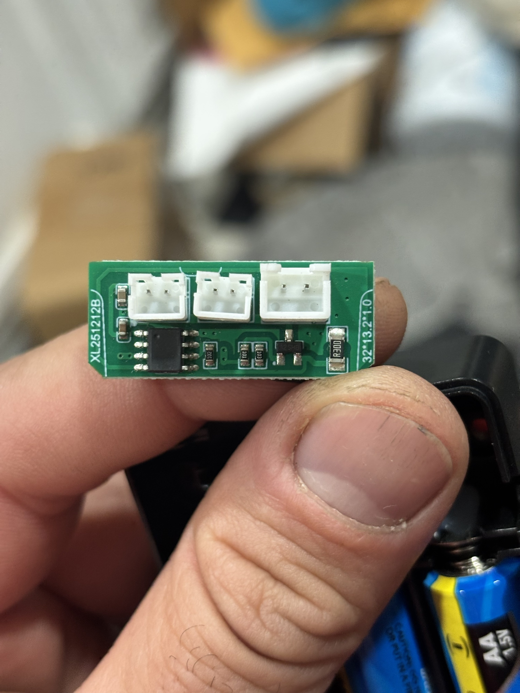
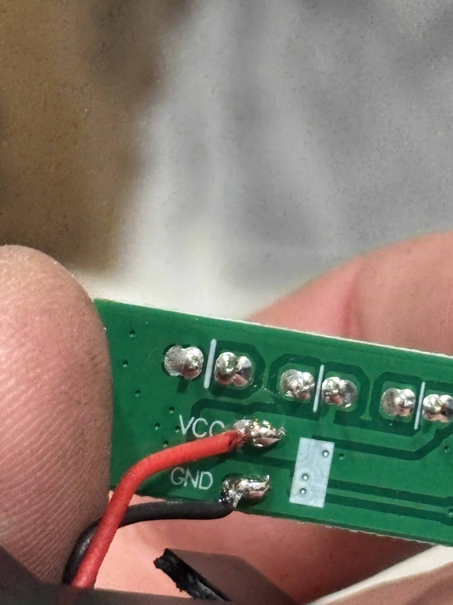
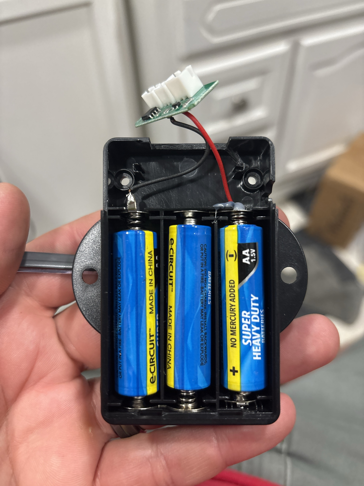

# Teardown: stock beer pong LED controller

| Front | Back | Power |
|---|---|---|
|  |  |  |

The kit has **two identical boxes** (one per side of the table), each with this board, two single-colour strips and a button.

Board silkscreen: `XL251212B`, `32*13.2*1.0` (32 × 13.2 mm, 1.0 mm thick PCB).

## Parts

| Ref (position) | Marking | Identification | Role |
|---|---|---|---|
| U1 (8-pin SOP, left) | none / sanded | Generic 8-pin OTP microcontroller (Padauk PMS150-class, FMD, etc.) | Reads the button, generates the flash/fade modes, drives the MOSFET |
| C1, C2 (left edge) | none | MLCC decoupling caps | Supply filtering for U1 |
| R `102` | 1 kΩ | Resistor | Probably in series with the button input (ESD/current limit) |
| R `101` | 100 Ω | Resistor | MOSFET gate resistor |
| R `103` | 10 kΩ | Resistor | Gate pull-down (keeps LEDs off while U1 boots/sleeps) |
| Q1 (SOT-23) | `A2SHB` | **SI2302** N-channel MOSFET, 20 V / ~2.8 A, logic level (fully on at 2.5 V Vgs) | Low-side switch for the LEDs |
| R `R300` (1206) | 0.30 Ω | Resistor | In series with the LED return path: crude current limit / sense |
| J1, J2, J3 | — | 2-pin JST-style headers (J1/J2 ~2.0 mm PH, J3 larger ~2.5 mm XH) | Strip A, strip B, button (to be confirmed, see below) |
| `VCC` / `GND` pads (back) | — | Battery input | Red/black straight from the 3×AA box |

## Power

- 3 × AA alkaline in series: **4.5 V fresh, ~3.3 V when dead**.
- No power switch anywhere. The stock MCU sleeps at micro-amps, and the button acts as a "soft" on/off.

## Inferred schematic

There is only **one** MOSFET, so both LED strips switch together. They are almost certainly in parallel, with + on VCC and − on the MOSFET drain.

```
 VBAT (4.5V) ──┬─────────────────────────┬──────────────┐
               │                         │              │
             [U1 VDD]                 J1 + (strip A)  J2 + (strip B)
               │                      J1 − ─┐         J2 − ─┐
  J3 button ──[1k]── U1 GPIO (pull-up)      └──────┬────────┘
  J3 other  ── GND                                 │ (drain)
               U1 GPIO ──[100R]──┬── gate  Q1 SI2302
                                 [10k]             │ (source)
                                  │              [0R30]
 GND ─────────────────────────────┴────────────────┴──── GND
```

## Verify with a multimeter (batteries out)

Continuity / diode mode:

1. **Which connector is the button?** Its pin goes to a U1 pin through the 1 k resistor. The LED connectors go to VCC and the MOSFET drain (the single pin on the top of the SOT-23).
2. **Are the strips in parallel?** Check that J1− and J2− both beep to Q1's drain.
3. **Strip LEDs:** probe a strip's connector with the meter in diode mode, red lead on + and black on −. If it lights faintly, it's a plain 2-wire LED string.

Also useful, with batteries in: measure the current in strip-on mode (meter in series with the battery's red wire). It tells us the LED load and expected battery life.
